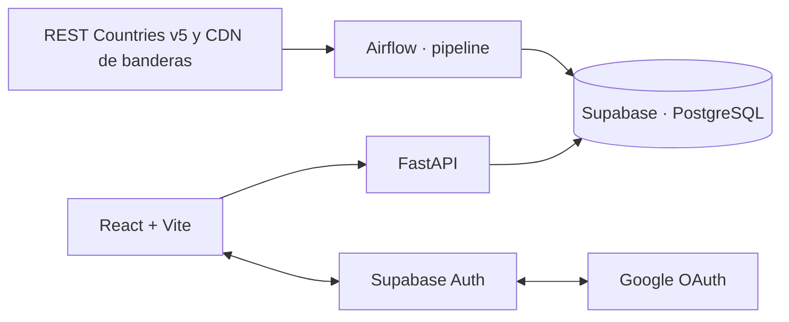

# Orbe · Explorador de países

Aplicación independiente de WEATHER, dentro de la carpeta existente **COUNTIRES**. Interfaz en español, catálogo responsive con banderas, búsqueda por nombre o código, filtro por región, orden y paginación. Al seleccionar una tarjeta, un modal muestra los detalles del país. Incluye inicio de sesión con Google mediante Supabase.

El catálogo incluye países y territorios según REST Countries; su inclusión no implica una clasificación política propia. Algunos datos del proveedor, como nombres de monedas y subregiones, se conservan en su idioma original.

La cobertura de esta versión requiere códigos alpha-2 y alpha-3 válidos para identificar registros y descargar banderas. REST Countries también devuelve registros sin ambos códigos: se excluyen explícitamente y se registra su cantidad en los logs. Se comprueba la paginación completa antes de publicar el subconjunto compatible; códigos parciales, datos malformados o descargas incompletas siguen bloqueando la publicación.

## Arquitectura



**Sólo el pipeline se comunica con REST Countries y su CDN.** FastAPI sólo consulta Supabase. React consulta FastAPI con el JWT del usuario y se comunica con Supabase Auth para la sesión. Las banderas también se guardan en PostgreSQL como PNG en base64 y se muestran con URLs `data:`: el navegador no consulta el proveedor ni el CDN. Tipografía, ilustración e iconos se sirven localmente.

No se reutilizan las cuentas, las variables de entorno, los procesos ni la base de datos de WEATHER. Se reutiliza su enfoque de arquitectura y las correcciones de autenticación. El nombre de carpeta `COUNTIRES` se conserva para respetar el directorio compartido.

| Servicio | Tecnología | Dirección |
|---|---|---|
| Frontend | React + Vite · JavaScript/JSX | http://127.0.0.1:5175 |
| Backend | FastAPI · entorno propio | http://127.0.0.1:8001 |
| Pipeline | Airflow 3.3.2 · entorno propio | http://127.0.0.1:8081 |
| Logs de Airflow | Worker / triggerer | 8893 / 8894 |

La metadata de Airflow usa SQLite local en `pipeline/.airflow`. Todos los datos de la aplicación viven en el **nuevo** proyecto Supabase. Sin Docker; ejecución local de desarrollo.

## 1. Instalar dependencias

Requisitos: Python **3.13**, Node.js **22.12 o posterior compatible con Vite 7**, npm. Se incluyen `package-lock.json` y archivos Python congelados; backend y pipeline usan entornos separados.

Desde `PRACTICAS_REACT`:

```sh
cd COUNTIRES
sh scripts/setup.sh
```

El script instala dependencias y copia los `.env.example` únicamente si no existe ya un `.env`. No sobrescribe credenciales. Los entornos ya creados en esta entrega están instalados; para configurar sólo las variables puedes copiar manualmente cada `.env.example` a `.env` en `frontend`, `backend` y `pipeline`.

Las dependencias de Airflow corresponden a Python 3.13. Para regenerar su entorno desde las dependencias directas, utiliza las [restricciones de Airflow 3.3.2 para Python 3.13](https://raw.githubusercontent.com/apache/airflow/constraints-3.3.2/constraints-3.13.txt), después congela las versiones y ejecuta las pruebas. No actualices Airflow al instalar dependencias del backend.

## 2. Crear el proyecto Supabase de COUNTRIES

1. Crea un **proyecto nuevo** en Supabase para esta práctica.
2. Abre su editor SQL y ejecuta completo `supabase/migrations/001_countries.sql`, una sola vez. La migración crea tablas, funciones y políticas RLS. No la ejecutes en WEATHER.
   En proyectos donde ya aplicaste la primera migración, ejecuta `supabase/migrations/002_safe_catalog_publication.sql` para corregir la publicación con la protección de DELETE de Supabase. No vuelvas a ejecutar `001` sobre las tablas existentes. La corrección conserva la transacción y los permisos y no elimina datos al aplicar la migración.
3. Copia la URL del nuevo proyecto y su clave **publishable** a `frontend/.env` y `backend/.env`.
4. Copia esa misma URL y una clave **secret** (`sb_secret_…`) o la clave heredada **service_role** a `pipeline/.env`, en `SUPABASE_SERVICE_ROLE_KEY`.
5. Mantén activa la API de datos de Supabase para el esquema `public`. Las funciones y políticas controlan quién puede leer o publicar.

| Archivo | Variables |
|---|---|
| `frontend/.env` | `VITE_SUPABASE_URL`, `VITE_SUPABASE_PUBLISHABLE_KEY`, `VITE_API_URL=http://127.0.0.1:8001` |
| `backend/.env` | `SUPABASE_URL`, `SUPABASE_PUBLISHABLE_KEY`, `ALLOWED_ORIGINS` |
| `pipeline/.env` | `SUPABASE_URL`, `SUPABASE_SERVICE_ROLE_KEY`, `RESTCOUNTRIES_API_KEY` |

La URL debe coincidir en los tres servicios. Ninguna clave privilegiada, clave REST Countries o secreto Google pertenece al frontend. Los archivos `.env` y las bases de Airflow se excluyen del control de versiones.

## 3. Configurar Google OAuth

1. En Google Cloud configura la pantalla de consentimiento y un cliente OAuth de tipo **aplicación web** para Orbe. Si está en pruebas, añade tu cuenta a los usuarios de prueba.
2. En el cliente Google, registra como URI de redirección autorizada la URL que muestra el proveedor Google de tu nuevo proyecto Supabase:
   `https://TU_PROYECTO_COUNTRIES.supabase.co/auth/v1/callback`.
3. Activa Google en Supabase Auth y guarda allí el client ID y el client secret de Google. No se guardan en los `.env` de esta aplicación.
4. En la configuración de URL de Supabase, usa `http://127.0.0.1:5175` como Site URL y permite las redirecciones:
   - `http://127.0.0.1:5175/auth/callback`
   - `http://localhost:5175/auth/callback`
5. Usa siempre el mismo origen para empezar y terminar el acceso. PKCE guarda un verificador en el navegador que debe mantenerse durante el proceso.
6. FastAPI valida los tokens mediante las claves públicas del proyecto: la clave de firma **activa** debe ser ES256 o RS256. Si el proyecto heredó HS256, migra a una clave asimétrica siguiendo la documentación de Supabase, activa la nueva clave y vuelve a iniciar sesión. Una clave en espera no cambia los tokens que ya se emiten.

La sesión usa la clave de almacenamiento `orbe-countries-auth`, diferente a la de WEATHER. Se implementan callback PKCE, restauración, renovación y cierre local de sesión. Un problema de configuración del backend devuelve 503 y no expulsa al usuario como si su sesión hubiera expirado. En macOS se agregan los certificados de `certifi` a la validación HTTPS; no se desactiva la verificación TLS.

Documentación: [Google en Supabase](https://supabase.com/docs/guides/auth/social-login/auth-google), [claves de firma](https://supabase.com/docs/guides/auth/signing-keys).

## 4. Obtener la clave del proveedor correcto

La documentación vigente de **REST Countries v5** utiliza `https://api.restcountries.com/countries/v5` y autenticación `Authorization: Bearer …`. Crea tu cuenta y clave en [REST Countries](https://restcountries.com/sign-up) y guárdala únicamente en `RESTCOUNTRIES_API_KEY` dentro de `pipeline/.env`.

No uses una clave de WeatherAPI ni de OpenWeather. La clave pública `rc_live_demo` sirve para comprobar el formato: devuelve sólo una muestra, no el catálogo real. El pipeline rechaza expresamente esa muestra para no reemplazar el catálogo con un solo país.

El pipeline pagina la respuesta con `limit=100`, comprueba el total anunciado, códigos únicos y un catálogo de 200–400 entradas. Después descarga las banderas PNG de 320 px desde el CDN oficial, con concurrencia limitada. Rechaza imágenes de otro formato, imágenes demasiado grandes, respuestas incompletas y redirecciones. No envía la clave API al CDN ni sigue URLs entregadas por los datos del proveedor.

Documentación: [Countries API v5](https://restcountries.com/docs/countries), [CDN de banderas](https://restcountries.com/flags). El número exacto de países/territorios depende del proveedor y se muestra desde la base de datos.

## 5. Ejecutar los servicios

Abre tres terminales y sitúate en `COUNTIRES` en cada una:

```sh
# Terminal 1
sh backend/run.sh
```

```sh
# Terminal 2
sh pipeline/run.sh
```

```sh
# Terminal 3
cd frontend
npm run dev
```

1. Abre http://127.0.0.1:5175 e inicia sesión con Google.
2. Si todavía no hay datos, pulsa **Cargar catálogo**. Se crea una solicitud en Supabase; el frontend no descarga países del proveedor.
3. El DAG `countries_process_requests` comprueba la cola cada minuto. La primera carga tarda unos minutos según la conexión, las banderas y el proveedor. La interfaz consulta su estado cada cinco segundos durante hasta tres minutos; después ofrece **Volver a consultar** y conserva el estado pendiente.
4. Usa la búsqueda en español, inglés, nombres nativos o códigos ISO. Combínala con una región y el orden por nombre, población o superficie. Selecciona una tarjeta para abrir los detalles.
5. Para detener los servicios, usa Ctrl+C en cada terminal. Para cambiar variables del pipeline, detén y reinicia **Airflow completo**; cambiar sólo el archivo no actualiza los procesos ya iniciados. Reinicia también FastAPI o Vite si cambias sus `.env`.

`airflow standalone` crea las credenciales de su panel local. Consulta la salida de tu propia terminal o el archivo de contraseñas dentro de `pipeline/.airflow`; esas credenciales no son las de Google ni Supabase. Los DAGs se crean activos. Si los pausas en el panel, debes volver a activarlos para procesar la cola.

## Actualización y almacenamiento

- `countries_schedule_catalog` revisa **cada hora** si la última publicación tiene al menos 24 horas. Si corresponde, pone una carga en la cola. Esto evita que pequeñas diferencias de horario salten un día completo de actualización.
- `countries_process_requests` procesa **cada minuto**, con un solo run activo.
- **Comprobar actualización** reutiliza un catálogo de menos de 24 horas o solicita uno nuevo si corresponde. Las solicitudes simultáneas comparten el trabajo; no revelan el identificador privado de otro usuario.
- Se mantiene solamente el último catálogo. Toda la sustitución se ejecuta en **una transacción PostgreSQL**, incluidas banderas, timestamps y resultado del job. Un fallo conserva el catálogo anterior.
- Una carga interrumpida puede recuperarse tras diez minutos. El número de intento evita que un proceso antiguo publique después de perder el trabajo. Hasta tres intentos por job para errores temporales; los errores de credenciales fallan sin reintentos automáticos de ese job.
- Los jobs operativos terminados se conservan siete días. Los datos se marcan antiguos tras 48 horas; siguen disponibles con su fecha de carga.

## Tablas y acceso

| Tabla | Contenido |
|---|---|
| `countries` | Última información y bandera de cada país; clave única ISO alpha-3 y alpha-2 |
| `catalog_state` | Última publicación, total, estado y error público saneado |
| `ingestion_jobs` | Cola de cargas con intentos, solicitante y estado |

Usuarios autenticados pueden leer el catálogo compartido y sus propios jobs. No pueden modificar países, publicar ni procesar trabajos. FastAPI pasa el token del usuario a Supabase para que se aplique RLS; sólo el pipeline tiene permisos de publicación. Los mensajes y logs de la aplicación no incluyen tokens ni el cuerpo de errores del proveedor.

| Endpoint | Propósito |
|---|---|
| `GET /health` | Disponibilidad local y presencia de configuración; no prueba conectividad externa |
| `GET /api/v1/catalog` | Resumen, regiones, actualización y estado |
| `GET /api/v1/countries?q=&region=&sort=name&page=1&page_size=12` | Buscar, filtrar, ordenar y paginar datos guardados |
| `GET /api/v1/countries/{ISO3}` | Detalle del país guardado |
| `POST /api/v1/catalog/refresh` | Reutilizar datos frescos (200) o encolar una carga (202) |
| `GET /api/v1/jobs/{uuid}` | Consultar un job propio; otro usuario obtiene 404 |

Documentación interactiva del backend: http://127.0.0.1:8001/docs.

## Pruebas y vista de diseño

```sh
sh scripts/test.sh
```

Incluye pruebas Python del backend y pipeline, pruebas React con Vitest y pruebas PostgreSQL con **PGlite** sobre la migración real: RLS, búsqueda con acentos, ausencia de duplicados, rollback, privacidad, reintentos y recuperación. PGlite es una base embebida **de prueba**, no sustituye Supabase ni se usa en producción.

Para comprobaciones locales de arranque, con los puertos correspondientes libres:

```sh
python3 scripts/smoke_local.py backend
python3 scripts/smoke_local.py pipeline
```

Estos comandos inician y detienen únicamente sus propios procesos; no detienen un servicio que ya esté usando el puerto. Sus logs locales se guardan en `.cache`.

Con Vite ejecutándose, http://127.0.0.1:5175/qa/ muestra una **vista de prueba** sin cuentas externas. Usa los mismos componentes de producción con doce países de ejemplo y banderas descargadas para QA. Las cifras de esa vista son fixtures y no son datos actuales. No permite acceder al catálogo real ni omite autenticación en la aplicación principal. Vite no incluye `qa/` en la compilación de producción.

Las capturas y los resultados locales se documentan en `docs/VALIDATION.md`. Las pruebas locales no demuestran que estén configurados Google, el proyecto remoto de Supabase ni una clave propia válida del proveedor. Para completar esa comprobación, configura las cuentas, aplica la migración y verifica el flujo de inicio de sesión → primera carga → catálogo → filtros → modal. Verifica además con dos usuarios reales la privacidad de sus jobs y en la pestaña de red del navegador que no hay solicitudes a REST Countries ni a su CDN.

## Problemas frecuentes

| Síntoma | Qué revisar |
|---|---|
| Login Google funciona, API devuelve 401 | URL/proyecto coincidente en frontend y backend; token Supabase, no token Google; firma activa ES256/RS256; cerrar sesión y volver a entrar |
| Backend devuelve 503 | `.env` del backend, HTTPS/certificados, conectividad con Supabase y migración aplicada |
| Jobs se quedan en `queued` | Airflow completo en ejecución, DAGs activos y `.env` del pipeline correcto |
| REST Countries rechaza la clave | Cuenta de **REST Countries**, clave propia sin espacios/comillas copiadas accidentalmente, variable correcta y reinicio completo de Airflow |
| Error de cuota / 403 | Estado y cuota de la cuenta del proveedor; se conserva el catálogo anterior |
| Una bandera falla / respuesta incompleta | Se rechaza la publicación completa; revisa el mensaje saneado del job y reintenta cuando el proveedor se recupere |
| Puerto ocupado | Puertos 5175/8001/8081 y 8893/8894; no cierres los servicios de WEATHER para iniciar esta app |

Los logs de descarga y publicación están en el panel Airflow, dentro del run y de la tarea `process`, y en `pipeline/.airflow/logs/dag_id=countries_process_requests/`. La terminal de `standalone` muestra principalmente la actividad de sus servicios. Una carga fallida se guarda en `ingestion_jobs.error` y hace fallar la tarea de Airflow; los reintentos del trabajo se controlan en la base de datos.

## Orden del código para estudiar el proyecto

1. `supabase/migrations/001_countries.sql`: modelo de datos, permisos, cola y publicación atómica.
2. `pipeline/countries_pipeline/transform.py`: transformación del formato v5 a campos propios de la aplicación.
3. `pipeline/countries_pipeline/provider.py`: paginación, validación y descarga de banderas.
4. `pipeline/countries_pipeline/database.py` y `jobs.py`: comunicación privilegiada con Supabase, procesamiento, errores y reintentos.
5. `pipeline/dags/countries_catalog.py`: programación de las dos tareas de Airflow.
6. `backend/app/config.py`, `auth.py`, `database.py`: configuración, validación del JWT y acceso con RLS.
7. `backend/app/models.py` y `main.py`: contratos y endpoints.
8. `frontend/src/auth.jsx` y `lib/api.js`: sesión Google/Supabase y solicitudes autenticadas a FastAPI.
9. `frontend/src/lib/useCatalog.js`: filtros, carga cancelable, debounce y consultas de estado.
10. `frontend/src/components/Catalog.jsx`, `CountryCard.jsx`, `CountryModal.jsx`: interfaz y detalle accesible.
11. `frontend/src/styles.css` y `readability.css`: composición responsive y ajustes de legibilidad.
12. Pruebas en cada servicio y `supabase/tests/database.test.mjs`: comprobación de los contratos anteriores.
