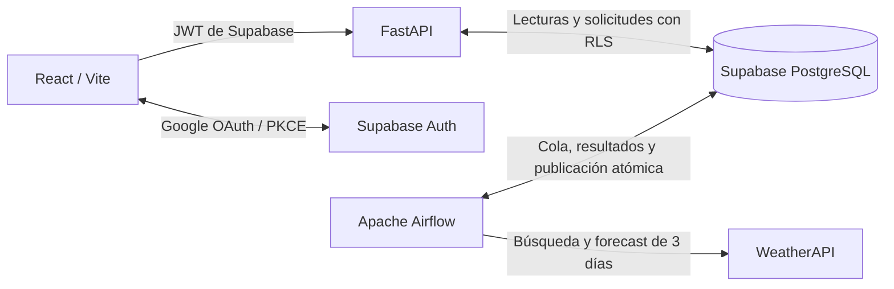

# Bruma · WEATHER

Aplicación del clima con **React + Vite (JavaScript/JSX)**, **FastAPI**, **Apache Airflow 3.3.2** y **Supabase**. Interfaz en español, inicio de sesión con Google y pronóstico de **hoy + dos días**. Se ejecuta localmente sin Docker. `COUNTIRES` no forma parte de esta práctica.

## Arquitectura



**El frontend y FastAPI nunca consultan WeatherAPI.** El frontend solo usa Supabase directamente para autenticación. Todas las consultas del clima pasan por FastAPI y leen datos guardados en Supabase. Las funciones de PostgreSQL aplican cambios relacionados en una sola transacción.

| Directorio | Responsabilidad |
| --- | --- |
| `frontend` | Dashboard, Google OAuth/PKCE, búsqueda, selección de días/horas y seguimiento de cargas |
| `backend` | API autenticada, validación de JWT y acceso a Supabase con el token de cada usuario |
| `pipeline` | DAGs, cliente de WeatherAPI, validación y transformación de los datos |
| `supabase/migrations` | Tablas, claves, políticas RLS y funciones de la cola/publicación |
| `scripts` | Preparación, pruebas y comprobación de arranque local |

## 1. Preparar los entornos

Requisitos: **Python 3.13**, **Node 20.19+ o 22.12+** y npm. En esta entrega se usaron Python 3.13 y Node 26. Cada servicio Python tiene su propia `.venv`; no se instalan dependencias globalmente.

Desde `WEATHER`:

```sh
sh scripts/setup.sh
```

El script instala los locks `requirements.txt` y `package-lock.json`, usa las restricciones oficiales de Airflow para Python 3.13 y crea los archivos `.env` a partir de los ejemplos **sin sobrescribir archivos existentes**. Los archivos `requirements.in` documentan las dependencias principales; los `.txt` fijan las versiones resueltas, incluidas las transitivas.

La carpeta de Airflow, sus credenciales locales generadas, los entornos virtuales, cachés y archivos `.env` están excluidos del control de versiones.

## 2. Crear y configurar Supabase

1. Crea un proyecto en [Supabase](https://supabase.com/dashboard). Guarda su URL y la **publishable key**.
2. En **SQL Editor**, ejecuta una sola vez el contenido completo de `supabase/migrations/001_weather.sql`. La migración está pensada para un proyecto nuevo y es transaccional. Las futuras migraciones deben aplicarse en orden; no vuelvas a ejecutar la inicial sobre las tablas creadas.
3. En **Authentication → Signing Keys**, utiliza una clave asimétrica **ES256 o RS256**. FastAPI verifica firma, emisor, audiencia `authenticated`, expiración, rol e identificador del usuario mediante JWKS. Un proyecto que conserve exclusivamente HS256 necesita configurar la clave asimétrica antes de usar este backend.
4. Para el pipeline, obtén una clave privada de servidor: la clave heredada **service_role** o una clave **secret** nueva. Nunca uses esa clave en el frontend ni en el backend de lectura.

### Modelo de datos

| Tabla | Clave / contenido |
| --- | --- |
| `locations` | UUID interno y `provider_id` único; nombre, región, país, coordenadas, zona horaria y última selección |
| `current_weather` | Una fila por ubicación; observación, fecha de carga y mediciones actuales |
| `daily_forecasts` | Ubicación + fecha local; mínima/máxima, condición, amanecer, atardecer, fase e iluminación lunar |
| `hourly_forecasts` | Ubicación + instante UTC; fecha local y mediciones por hora, incluido UV |
| `location_search_cache` | Consulta normalizada, candidatos guardados y caducidad de 24 horas |
| `ingestion_jobs` | Solicitud de búsqueda/clima, usuario, estado, intentos, arrendamiento temporal y error público saneado |
| `user_recent_locations` | Ubicación + usuario; conserva sus cinco últimas selecciones |

Los usuarios autenticados pueden leer el clima compartido. Las solicitudes y ubicaciones recientes están aisladas por `auth.uid()`. No hay permisos de escritura directa para el navegador: las solicitudes se presentan mediante funciones controladas. Las funciones de procesamiento y publicación solo admiten el rol de servidor del pipeline. Todos los permisos `EXECUTE` públicos se revocan explícitamente.

## 3. Configurar Google OAuth

1. Crea un proyecto en [Google Cloud Console](https://console.cloud.google.com/) y configura la pantalla de consentimiento de OAuth. Si la aplicación está en modo de prueba, agrega las cuentas de prueba permitidas.
2. Crea un cliente OAuth de tipo **Aplicación web**.
3. Agrega `http://localhost:5173` como origen JavaScript autorizado. Si también usarás `http://127.0.0.1:5173`, agrégalo como otro origen.
4. En las URI de redirección autorizadas de **Google**, agrega la URL HTTPS del callback de tu proyecto Supabase:

   ```text
   https://TU_PROYECTO.supabase.co/auth/v1/callback
   ```

5. En **Supabase → Authentication → Sign In / Providers → Google**, habilita Google y guarda allí el Client ID y Client Secret. El secreto de Google no se coloca en ningún archivo del frontend.
6. En **Supabase → Authentication → URL Configuration**, establece el Site URL en `http://localhost:5173` y permite estas redirecciones exactas:

   ```text
   http://localhost:5173/auth/callback
   http://127.0.0.1:5173/auth/callback
   ```

7. Deja Google como proveedor de acceso de esta práctica; deshabilita el proveedor Email si no se va a utilizar. La aplicación no incluye acceso por contraseña ni registro alternativo.

Hay dos callbacks distintos: **Google redirige a Supabase**; después **Supabase redirige al frontend**. El frontend intercambia el código PKCE una sola vez, restaura la sesión, escucha su renovación y envía el JWT de Supabase a FastAPI. No se almacenan tokens de acceso a otros servicios de Google. El cierre de sesión elimina la sesión local de este navegador.

Guía oficial: [Google con Supabase](https://supabase.com/docs/guides/auth/social-login/auth-google).

## 4. Obtener la clave de WeatherAPI y completar los archivos .env

Crea una cuenta en [WeatherAPI](https://www.weatherapi.com/), obtén su API key y confirma que la cuenta incluya pronóstico de tres días. El plan gratuito publicado permite **100 000 llamadas al mes**. A una llamada por ciudad cada 30 minutos, una ciudad continuamente activa utiliza aproximadamente 1 440 llamadas en 30 días, más búsquedas, primeras cargas y reintentos. Esta práctica está pensada para pocos usuarios; monitorea la cuota del proveedor antes de aumentar el número de ciudades.

| Archivo | Variables |
| --- | --- |
| `frontend/.env` | `VITE_SUPABASE_URL`, `VITE_SUPABASE_PUBLISHABLE_KEY`, `VITE_API_URL=http://127.0.0.1:8000` |
| `backend/.env` | `SUPABASE_URL`, `SUPABASE_PUBLISHABLE_KEY`, `ALLOWED_ORIGINS` como arreglo JSON de orígenes locales |
| `pipeline/.env` | `SUPABASE_URL`, `SUPABASE_SERVICE_ROLE_KEY`, `WEATHERAPI_KEY` |

Reinicia el servicio correspondiente después de cambiar su configuración. Nunca pongas una API key privada en una variable que empiece por `VITE_`. Las claves de ejemplo no permiten acceso real.

## 5. Ejecutar los tres servicios

Abre tres terminales desde `WEATHER`:

```sh
# Terminal 1 · FastAPI
sh backend/run.sh
```

```sh
# Terminal 2 · Airflow: API, scheduler, DAG processor y triggerer
sh pipeline/run.sh
```

```sh
# Terminal 3 · React / Vite
cd frontend
npm run dev
```

- Aplicación: [localhost:5173](http://localhost:5173).
- Documentación de FastAPI: [127.0.0.1:8000/docs](http://127.0.0.1:8000/docs).
- Disponibilidad del backend: [127.0.0.1:8000/health](http://127.0.0.1:8000/health). `configured` indica que se cargó la configuración, no prueba conectividad ni migraciones remotas.
- Airflow: [127.0.0.1:8080](http://127.0.0.1:8080). La contraseña de administración se genera localmente en `pipeline/.airflow/simple_auth_manager_passwords.json.generated`; consúltala localmente y no la compartas.

`run.sh` fija `AIRFLOW_HOME` dentro del proyecto y carga exclusivamente los dos DAGs de la práctica. Usa un SQLite local **solo para metadatos de Airflow** y paralelismo reducido. Los datos de la aplicación se guardan en Supabase. Este despliegue standalone es de desarrollo; producción requeriría infraestructura y configuración distintas.

Sin configurar las cuentas puedes abrir la aplicación y ver las instrucciones de preparación. Para revisar únicamente la apariencia, visita [la página de pruebas visuales](http://127.0.0.1:5173/qa/) con Vite en ejecución. **Usa datos ficticios claramente señalados**, no tiene acceso autenticado ni realiza consultas; el build de producción no incluye esa página.

## Funcionamiento de la cola

1. El usuario inicia sesión y envía una búsqueda explícita de 2–100 caracteres. No se consume la cuota del proveedor por cada tecla.
2. FastAPI llama `submit_search` con el token del usuario. Una consulta en caché devuelve candidatos inmediatamente; otra crea una solicitud y devuelve **202**.
3. `weather_process_requests` se ejecuta cada minuto, reclama solicitudes mediante bloqueo de fila y un arrendamiento de dos minutos, busca en WeatherAPI y publica candidatos en Supabase.
4. El usuario distingue candidatos por ciudad, región y país. Seleccionarlos registra la ciudad, activa su seguimiento y reutiliza un pronóstico reciente o encola su carga.
5. Airflow consulta `forecast.json` con el identificador del proveedor, `days=3` y `lang=es`. Valida las fechas locales, horas únicas, rangos y estructura antes de publicar en una transacción. No usa URLs de iconos remotos.
6. El frontend consulta el estado cada cinco segundos. Tras tres minutos muestra una acción de **volver a consultar**, que conserva la solicitud pendiente. No garantiza un plazo de finalización si Airflow está detenido o existe una cola grande.
7. `weather_refresh_locations` se ejecuta cada 30 minutos y encola ciudades seleccionadas en las últimas 24 horas. El frontend relee el clima guardado cada minuto mientras está visible. Volver a seleccionar una ciudad reactiva el seguimiento.

Los intentos transitorios usan espera creciente y un máximo de tres intentos por solicitud. Errores de credenciales o cuota del proveedor terminan esa solicitud sin reintentos automáticos. Una nueva selección o un ciclo posterior puede crear otra solicitud; corrige el problema de la cuenta antes de mantener Airflow ejecutándose con una cuota agotada. Los arrendamientos vencidos se recuperan y sus tokens impiden publicar desde un intento antiguo.

La última carga válida se conserva si falla la siguiente. Una carga de más de 35 minutos, o que ya no cubra tres fechas locales, se muestra como desactualizada. Las respuestas filtran las fechas del horizonte actual para no presentar días pasados como próximos. Los errores públicos no contienen URLs con claves, SQL ni respuestas privadas del proveedor. Las solicitudes terminadas se eliminan tras siete días.

## Datos y presentación

- Temperatura actual, mínima/máxima, sensación térmica, condición, presión, humedad y nubosidad.
- Viento en km/h, ráfagas, grados y brújula de procedencia: **270° significa desde el oeste**, no hacia el oeste.
- Fechas locales para el pronóstico; instantes UTC para observaciones y horas. Se distingue el cambio de horario mediante epochs únicos.
- Amanecer, atardecer, ocho fases lunares traducidas e iluminación lunar. Ausencias polares se guardan como `NULL`.
- UV por hora con valores numéricos; los valores ausentes se conservan como `NULL`, diferentes de cero.
- El panel principal siempre muestra **Ahora**. Elegir otro día selecciona su pronóstico de mediodía; elegir una hora cambia los detalles, brújula y métricas a **Pronóstico**. El sol, la luna y la gráfica UV siguen el día elegido. El botón **Ahora** restaura las condiciones actuales.
- Presión de WeatherAPI en milibares transformada a hPa: 1 mb = 1 hPa.

## Contrato HTTP

Todas las rutas `/api/v1` requieren `Authorization: Bearer <JWT de Supabase>`.

| Método y ruta | Resultado |
| --- | --- |
| `POST /api/v1/searches` con `{"query":"Paris"}` | 200 con `results`, o 202 con `job_id` |
| `GET /api/v1/jobs/{id}` | Estado y resultado de una solicitud propia; 404 para las ajenas |
| `POST /api/v1/locations/{id}/select` | 200 con clima reciente, o 202 con solicitud y datos anteriores si existen |
| `GET /api/v1/locations/{id}/weather` | `location`, `current`, `days`, `hours`, `stale`; `current` puede ser null antes de la primera carga |
| `GET /api/v1/me/recent-locations` | Hasta cinco objetos con `selected_at` y `location`, incluida una vista previa del clima |
| `GET /health` | Comprobación pública del proceso |

Los estados de la cola son `queued`, `processing`, `completed`, `failed`. Las solicitudes nuevas se limitan a diez por minuto por usuario; repetir una solicitud pendiente la reutiliza. El límite no afecta consultas que ya estén en caché.

## Pruebas

```sh
# Backend + pipeline + React + PostgreSQL embebido + build
sh scripts/test.sh

# Arranque real local; cada comprobación detiene únicamente el proceso que creó
python3 scripts/smoke_local.py backend
python3 scripts/smoke_local.py pipeline
```

Las pruebas de base de datos usan **PGlite (PostgreSQL embebido)** y simulan el esquema `auth`, roles y claims de Supabase. Ejecutan la migración real y comprueban RLS, permisos, publicación transaccional, caché, recuperación y eliminación de duplicados. No sustituyen una prueba del proyecto remoto ni de PostgREST.

Las pruebas de React cubren autenticación simulada, PKCE de un solo uso, renovación, cierre de sesión, búsquedas y respuestas antiguas, carga pendiente y distinción de pronóstico/observación. Las del pipeline usan fixtures, incluidas jornadas de 23 y 25 horas. La vista de QA permite revisar 360, 768 y 1440 píxeles sin credenciales.

### Verificación pendiente de las cuentas

Una vez configuradas, comprueba el acceso real con Google, una búsqueda que no exista en caché, su paso por Airflow, los registros publicados y la lectura posterior desde FastAPI. Con dos cuentas, revisa que ninguna pueda leer las solicitudes o destinos recientes de la otra. En la pestaña de red del navegador verifica que no haya solicitudes a WeatherAPI y que solo Airflow tenga su clave. Estas pruebas reales necesitan las credenciales y no se consideran aprobadas por las pruebas con fixtures.

### Problemas frecuentes

| Síntoma | Comprobación |
| --- | --- |
| Instrucciones de configuración en la bienvenida | Edita `frontend/.env` y reinicia Vite |
| Google muestra un error de redirección | Compara el callback de Google hacia Supabase y el callback permitido de Supabase hacia Vite |
| FastAPI rechaza la sesión | Usa el JWT de Supabase, no el token de Google; revisa URL del proyecto, firma asimétrica y expiración |
| Google permite entrar, pero FastAPI responde 401 | Consulta la línea `Supabase session rejected`: incluye el tipo de rechazo y el algoritmo de firma, sin imprimir el token. Una clave ES256 en estado standby no significa que Supabase ya la esté usando; revisa cuál figura como activa/current |
| Aparece `Supabase Data API rejected access` | La sesión superó el verificador local y Supabase rechazó la consulta. El código del aviso distingue problemas de JWT, clave de API o permisos; no agregues permisos anónimos para resolver una consulta que debe estar autenticada |
| «No se pudo verificar la sesión» y HTTP 503 | FastAPI no pudo descargar las claves públicas de Supabase. Revisa la conexión y el tipo de error que aparece como `Supabase JWKS connection failed`. El verificador carga certificados de `certifi` además de las raíces de confianza predeterminadas; reinicia FastAPI después de actualizar el código |
| Carga pendiente durante varios minutos | Revisa que Airflow esté ejecutándose y los DAGs estén habilitados; consulta sus tareas y la cola |
| Error de base de datos | Aplica la migración al mismo proyecto configurado en los servicios y revisa sus permisos |
| Clima viejo o cuota agotada | Conserva los datos anteriores; revisa la cuenta de WeatherAPI y sus límites antes de reintentar |
| WeatherAPI 2006 en `ingestion_jobs.error` | La API key es inválida: copia la clave de tu cuenta de WeatherAPI a `pipeline/.env` como `WEATHERAPI_KEY`, reinicia Airflow y repite la búsqueda |
| Puerto ocupado | Detén el servicio anterior o cambia los puertos y las URLs/CORS/callbacks de manera consistente |

Referencias: [WeatherAPI forecast](https://www.weatherapi.com/docs/forecast-api/), [límites](https://www.weatherapi.com/pricing), [Supabase JWT](https://supabase.com/docs/guides/auth/jwts), [Airflow standalone](https://airflow.apache.org/docs/apache-airflow/stable/start.html).

En instalaciones de Python de python.org para macOS, el instalador incluye un paso adicional para instalar certificados de confianza. El backend usa el paquete `certifi` de su propia `.venv` para que la descarga de JWKS también funcione si ese paso no se realizó. La validación HTTPS y la verificación de firma, emisor, audiencia y expiración del JWT permanecen activadas. [Documentación de Python para macOS](https://docs.python.org/3.13/using/mac.html).

### Diagnosticar un 401 sin compartir credenciales

Después de reiniciar FastAPI, reproduce el acceso y copia únicamente uno de estos avisos del backend:

```text
Supabase session rejected (TIPO_DE_ERROR; signing_algorithm=ALGORITMO).
Supabase Data API rejected access (status=ESTADO; code=CODIGO).
```

El primero indica un rechazo durante la verificación del token; el segundo ocurre en la consulta a Supabase. El frontend conserva el mensaje de rechazo en la bienvenida. Una clave de API no válida o que no pueda utilizarse para el recurso se informa como configuración del backend (503), sin atribuirlo a una sesión vencida ni cerrar innecesariamente el acceso con Google.

Los JWT heredados HS256 requieren verificación con Supabase Auth o una configuración compatible; este backend actualmente verifica ES256/RS256 mediante JWKS. Supabase publica las claves asimétricas standby antes de empezar a firmar con ellas: ver una clave en JWKS, por sí solo, no demuestra qué algoritmo utiliza una sesión concreta. [Claves de firma de Supabase](https://supabase.com/docs/guides/auth/signing-keys).

### Búsquedas rechazadas por WeatherAPI

Los errores guardados identifican su código: **2006**, clave inválida; **2007**, cuota mensual agotada; **2008**, clave deshabilitada; **2009**, recurso no permitido por el plan. El mensaje no incluye la clave ni el texto original del proveedor. Estos errores no se reintentan automáticamente.

Para corregir un 2006, entra en tu cuenta de [WeatherAPI](https://www.weatherapi.com/my/), copia únicamente su API key y actualiza `WEATHERAPI_KEY` en `pipeline/.env`. Es una credencial distinta de las claves de Supabase y Google. Reinicia Airflow con `sh pipeline/run.sh` desde `WEATHER` y envía una nueva búsqueda. Si habías exportado `WEATHERAPI_KEY` en la terminal, actualiza o elimina esa variable antes de reiniciar: las variables del proceso tienen prioridad sobre `.env`.

**WeatherAPI.com y OpenWeather son proveedores diferentes.** Las claves de `home.openweathermap.org/api_keys` no autentican solicitudes a `api.weatherapi.com`. Esta práctica usa WeatherAPI.com: obtén la credencial de `weatherapi.com/my`. Cambiar a OpenWeather requeriría adaptar los endpoints y la transformación de datos; no basta con intercambiar la clave.

Las solicitudes anteriores permanecen como `failed`; repetir la búsqueda crea otra solicitud. Para los trabajos `kind=search`, `location_id=NULL` es correcto, porque la búsqueda todavía está descubriendo candidatos. No hace falta modificar esos registros ni la migración SQL. [Códigos oficiales de WeatherAPI](https://www.weatherapi.com/docs/error-codes/).
